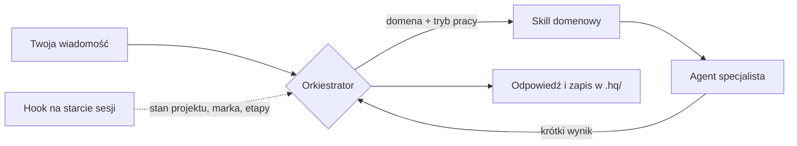

<div align="center">

# hq

**Zespół specjalistów w Claude Code.** Piszesz jak zwykle, a hq dobiera właściwego agenta, pamięta projekt i pilnuje marki.

[](hq/CHANGELOG.md)
[](https://docs.claude.com/en/docs/claude-code)
[](hq/agents)
[](hq/skills)
[](LICENSE)

[Instalacja](#instalacja) · [Jak używać](#jak-używać) · [Jak to działa](#jak-to-działa) · [Aktualizacja](#aktualizacja) · [Problemy](#gdy-coś-nie-działa)

</div>

> [!NOTE]
> **English:** the plugin's instructions are written in Polish, but Claude answers and writes project files in your language. Install it and chat as usual.

## Co dostajesz

- **Właściwy specjalista do zadania.** Kod, UX i styl UI, marka, elektronika, PM, budżet, marketing, prawo, bezpieczeństwo. Nie musisz znać nazw komend.
- **Pamięć projektu.** Stan, decyzje i następny krok leżą w `.hq/` i wracają w każdym nowym czacie.
- **Jedna marka w wielu projektach.** Organizacja ma brandbook, projekty go dziedziczą albo świadomie rozszerzają.
- **Teksty bez stylu AI.** Bez wstępów, oczywistości i pustych słów; skrypt `textcheck.py` wskazuje zdania do przepisania.
- **Mały koszt kontekstu.** Stale ładuje się ~1,5k tokenów, reszta dopiero wtedy, gdy jest potrzebna.

## Instalacja

Potrzebujesz tylko [Claude Code](https://docs.claude.com/en/docs/claude-code).

**1. Dodaj marketplace**
```bash
claude plugin marketplace add macno675/hq-claude-plugin
```

**2. Zainstaluj plugin** (dla wszystkich Twoich projektów)
```bash
claude plugin install hq@hq-marketplace --scope user
```

**3. Przygotuj projekt.** Otwórz Claude Code w folderze projektu i wpisz:
```text
/hq:init
```
Init zakłada `.hq/` (pamięć projektu) i dopisuje krótki blok do `CLAUDE.md`. W istniejącym repo najpierw mapuje kod, polecenia i kolory. Niczego nie naprawia bez Twojej zgody.

**4. Sprawdź, czy działa**
```text
/hq:init check
```
Diagnostyka pokazuje wersję pluginu, potrzebne narzędzia, blok w `CLAUDE.md`, pliki `.hq/` i hook startowy.

> [!TIP]
> Zainstaluj `jq` (`brew install jq`). Bez niego hq nie podpowiada przy prośbach bez komendy i nie ostrzega o długiej rozmowie.

## Jak używać

Po prostu pisz. Komendy (`/hq:...`) działają, ale nie są potrzebne.

| Piszesz | Co się dzieje |
|---|---|
| „Zrób proszę wizualizację panelu administracyjnego” | Najpierw fundament: po co, dla kogo, główne zadania, dane. Claude proponuje założenia, pyta tylko o to, co zmienia projekt, potem prowadzi: makieta → styl → kod. Każdy etap zatwierdzasz Ty. |
| „Pokaż szybko trzy pomysły na stronę restauracji” | Tryb szkicu: wynik od razu, założenia opisane, bez procesu. |
| „Zatwierdzam makietę, dalej” | Kontynuacja od miejsca, w którym skończyliście, także w nowym czacie. |
| „Zmień kolory panelu na ciemne, układ zostaje” | Zmiana tylko warstwy wyglądu, reszta zostaje. |
| „Napisz teksty do ekranu logowania” | Krótkie komunikaty wg zasad pisania i głosu marki, sprawdzone `textcheck.py`. |
| „Załóż organizację Acme, projekty trzymam w ~/Projects/Acme” | Powstaje rejestr organizacji. Jeśli masz logo, stronę albo kod, marka zostaje z nich odtworzona. |
| „Sprawdź, czy aplikacja trzyma się marki, i popraw błędy” | `brandscan.py` wskazuje obce kolory i fonty z plikiem i linią, poprawki idą przez tokeny. |
| „Zaplanuj urządzenie IoT od pomysłu do pilotażowej partii” | Plan na domeny (produkt, elektronika, PM, budżet) z bramkami zgody przed produkcją. |

> [!IMPORTANT]
> Wysyłkę, publikację, płatności, usuwanie danych, umowy i wdrożenia hq tylko przygotowuje. Decyzja zawsze należy do Ciebie.

## Jak to działa



1. **Hook na starcie sesji** podaje Claude'owi kilka linii: organizację, markę, `.hq/context.md` i etap projektu.
2. **Orkiestrator** ustala domenę (np. UI, marka, budżet) i tryb pracy (nowy projekt, kontynuacja, poprawka, szkic, audyt).
3. **Skill domenowy** prowadzi etapy i bramki, a **agent** wykonuje pracę we własnym kontekście i wraca z krótkim wynikiem.
4. **Stan** trafia do `.hq/`, więc następny czat zaczyna tam, gdzie skończył poprzedni.

Gdy brakuje wiedzy z zewnątrz, pomysłów albo obrazu, hq daje gotowy prompt do Perplexity, ChatGPT lub Gemini. Wklejasz odpowiedź, a Claude sprawdza ją przed użyciem.

<details>
<summary><b>Wszystkie obszary (32 skille, 37 agentów)</b></summary>

| Obszar | Skille |
|---|---|
| Sterowanie i pamięć | `orchestrator`, `init`, `context`, `org` |
| Produkt i strategia | `product`, `product-management`, `tech-strategy`, `ai-strategy`, `executive`, `operations` |
| Projektowanie i kod | `views` (makiety), `look` (styl UI), `ux-ui`, `frontend`, `backend` |
| Marka i komunikacja | `brand`, `marketing`, `partnerships`, `customer-success` |
| Sprzęt | `electronics`, `av-production`, `it-infrastructure` |
| Zarządzanie | `pm`, `budget`, `finance`, `team-lead`, `data-analysis`, `event` |
| Ryzyko | `legal-safety`, `cybersecurity` |
| Wiedza z zewnątrz | `research`, `external-ai` |

Agenci są w [`hq/agents/`](hq/agents), każdy z ograniczoną listą narzędzi.
</details>

## Pamięć: organizacja, projekt, miniprojekt

| Poziom | Gdzie | Co trzyma |
|---|---|---|
| Organizacja | `~/.hq/orgs/<slug>/` | `org.md` (krótko o firmie), `paths` (foldery projektów), `brand/` (marka) |
| Projekt | `<projekt>/.hq/` | `context.md` (pamięć), `handoff.md`, wątki czatów, statusy etapów, profil marki |
| Miniprojekt | dowolny folder | nic albo jeden `context.md` |

Organizację hq rozpoznaje po folderze. Rejestr leży poza repozytoriami, w `~/.hq` (inne miejsce ustawisz zmienną `HQ_HOME`); możesz go trzymać w osobnym repo i dzielić z zespołem. Bez organizacji folder jest samodzielnym projektem.

<details>
<summary><b>Tryby marki projektu</b></summary>

| Tryb | Kiedy | Co wolno |
|---|---|---|
| `dziedziczy` (domyślny) | projekt wygląda jak organizacja | tylko elementy własne, np. nazwa produktu |
| `rozszerza` | sub-marka z własnym charakterem | zmienić elementy elastyczne, rdzeń zostaje |
| `odrębna-zgodna` | projekt wymaga innego designu | własna identyfikacja z zasadami zgodności, np. „by Acme” |
| `niezależna` | projekt klienta, eksperyment | wszystko, bez związku z organizacją |

Rdzeń i elementy elastyczne opisuje sekcja 0 brandbooka organizacji. Rdzeń zmienia się tylko decyzją dla całej organizacji.
</details>

## Aktualizacja

> [!IMPORTANT]
> Najpierw odśwież marketplace. Bez tego `update` nie widzi nowej wersji.

```bash
claude plugin marketplace update hq-marketplace
```
```bash
claude plugin update hq@hq-marketplace
```

Potem w każdym projekcie z `.hq/` uruchom `/hq:init`. Odświeży tylko blok hq w `CLAUDE.md`, reszty nie rusza. Zmiany w wersjach: [CHANGELOG](hq/CHANGELOG.md).

## Opcjonalne narzędzia

Plugin działa bez nich, tracisz tylko daną funkcję.

| Narzędzie | Do czego |
|---|---|
| `jq` | podpowiedzi przy prośbach bez komendy, ostrzeżenia o długiej rozmowie |
| `python3` | skrypty: budżet, harmonogram, RICE, audyt marki, `textcheck` |
| `node` + Playwright | makiety, styl UI i grafiki jako HTML/SVG ze zrzutami |
| konta Perplexity, ChatGPT, Gemini (bez API) | `hq:external-ai`: wklejasz prompt, odsyłasz odpowiedź |
| `ffmpeg` | pomiar głośności audio |
| MCP EasyEDA Pro, klucze LCSC | elektronika: schemat, PCB, części |

## Gdy coś nie działa

<details>
<summary><b>Claude nie używa hq albo robi wszystko sam</b></summary>

Wpisz `/hq:init check`. Najczęstsze przyczyny: stara wersja pluginu (zrób [aktualizację](#aktualizacja)), brak bloku hq w `CLAUDE.md` albo brak `jq`.
</details>

<details>
<summary><b>Nie widzę nowych skilli po wydaniu wersji</b></summary>

Zainstalowaną wersję znajdziesz w `~/.claude/plugins/installed_plugins.json`. Odśwież marketplace, zaktualizuj plugin i zacznij nowy czat.
</details>

<details>
<summary><b>Rozmowa jest za długa</b></summary>

hq sam podpowie `/compact` albo nowy czat. Stan zostaje w `.hq/context.md` i w pliku wątku, więc nowy czat wie, gdzie skończyliście.
</details>

## Rozwój

<details>
<summary><b>Praca nad pluginem i wydania</b></summary>

- Lokalnie: `claude plugin marketplace add /ścieżka/do/repo`. Zmiany działają od następnej sesji.
- Przed wydaniem: `python3 tools/check.py` (odwołania, selftesty skryptów, walidacja) i `bash tools/test_hooks.sh`.
- Wydanie: podbij `version` w `hq/.claude-plugin/plugin.json` i dopisz `hq/CHANGELOG.md`. Bez nowej wersji użytkownicy nie dostaną aktualizacji.
- Nowy agent: plik w `hq/agents/` z polem `tools:` i wiersz w tabeli routingu w `hq/skills/orchestrator/SKILL.md`.
- Scenariusze testowe: `hq/evals/` (prośba i kryteria oceny).
</details>

## Licencja

MIT © 2026 Maciej Bobrowski. Treść: [LICENSE](LICENSE).
